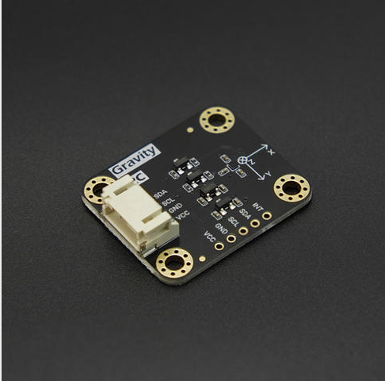
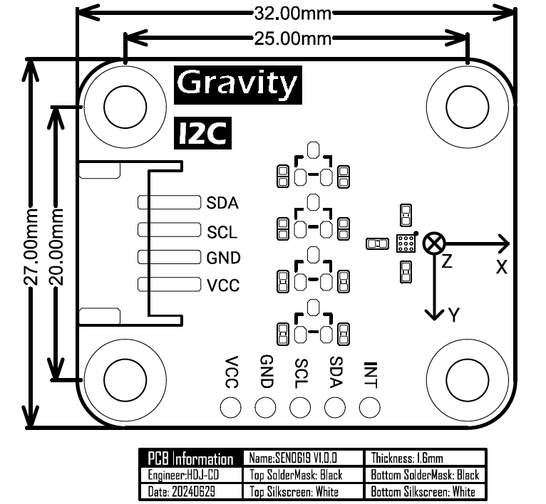

# DFRobot_BMM350

* [中文](./README_CN.md)

The BMM350 is a low-power and low noise 3-axis digital geomagnetic sensor that perfectly matches the requirements of compass applications. Based on Bosch’s proprietary FlipCore technology, the BMM350 provides absolute spatial orientation and motion vectors with high accuracy and dynamics. Featuring small size and lightweight, it is also especially suited for supporting drones in accurate heading. The BMM350 can also be used together with an inertial measurement unit consisting of a 3-axis accelerometer and a 3-axis gyroscope.



## Product Link（[https://www.dfrobot.com](https://www.dfrobot.com)）

```yaml
SKU: SEN0619
```

## Table of Contents

* [Summary](#summary)
* [Installation](#installation)
* [Methods](#methods)
* [Compatibility](#compatibility)
* [History](#history)
* [Credits](#credits)

## Summary

Get geomagnetic data along the XYZ axis.

1. This module can obtain high threshold and low threshold geomagnetic data. <br>
2. Geomagnetism on three(xyz) axes can be measured.<br>
3. This module can choose I2C or I3C communication mode.<br>

## Installation

To use this library download the zip file, uncompress it to a folder named DFRobot_BMM350.
Download the zip file first to use this library and uncompress it to a folder named DFRobot_BMM350.

## Methods

```C++
  /**
   * @fn softReset
   * @brief Soft reset, restore to suspended mode after soft reset.
   */
  void softReset(void);

  /**
   * @fn magneticReset
   * @brief Perform a magnetic reset (bit reset followed by flux guide reset) and wait for it to complete.
   * @n It is needed after the sensor has been exposed to a strong magnetic field shock. Other settings are kept.
   * @return true on success, false on failure
   */
  bool magneticReset(void);

  /**
   * @fn setOperationMode
   * @brief Set sensor operation mode
   * @param powermode
   * @n eBmm350SuspendMode      suspend mode: Suspend mode is the default power mode of BMM350 after the chip is powered, Current consumption in suspend mode is minimal, 
   *                                           so, this mode is useful for periods when data conversion is not needed. Read and write of all registers is possible.
   * @n eBmm350NormalMode       normal mode: Get geomagnetic data normally.      
   * @n eBmm350ForcedMode       forced mode: Single measurement, the sensor restores to suspend mode when the measurement is done.
   * @n eBmm350ForcedModeFast  To reach ODR = 200Hz is only possible by using FM_ FAST.
   */
  void setOperationMode(enum eBmm350PowerModes_t powermode);


  /**
   * @fn getOperationMode
   * @brief Get sensor operation mode
   * @return result Return sensor operation mode as a character string
   */
  String getOperationMode(void);

  /**
   * @fn setPresetMode
   * @brief Set preset mode, make it easier for users to configure sensor to get geomagnetic data (The default collection rate is 12.5Hz)
   * @param presetMode
   * @n BMM350_PRESETMODE_LOWPOWER       Low power mode, get a fraction of data and take the mean value.
   * @n BMM350_PRESETMODE_REGULAR        Regular mode, get a number of data and take the mean value.
   * @n BMM350_PRESETMODE_ENHANCED       Enhanced mode, get a plenty of data and take the mean value.
   * @n BMM350_PRESETMODE_HIGHACCURACY   High accuracy mode, get a huge number of data and take the mean value.
   */
  void setPresetMode(uint8_t presetMode, uint8_t rate = BMM350_DATA_RATE_12_5HZ);

  /**
   * @fn setRate
   * @brief Set the rate of obtaining geomagnetic data, the higher, the faster (without delay function)
   * @param rate
   * @n BMM350_DATA_RATE_1_5625HZ
   * @n BMM350_DATA_RATE_3_125HZ
   * @n BMM350_DATA_RATE_6_25HZ
   * @n BMM350_DATA_RATE_12_5HZ  (default rate)
   * @n BMM350_DATA_RATE_25HZ
   * @n BMM350_DATA_RATE_50HZ
   * @n BMM350_DATA_RATE_100HZ
   * @n BMM350_DATA_RATE_200HZ
   * @n BMM350_DATA_RATE_400HZ
   */
  void setRate(uint8_t rate);

  /**
   * @fn getRate
   * @brief Get the config data rate, unit: HZ
   * @return rate
   */
  float getRate(void);

  /**
   * @fn selfTest
   * @brief The sensor self test, the returned value indicate the self test result.
   * @param testMode:
   * @n     eBmm350SelfTestNormal               Normal self test, test whether x-axis, y-axis and z-axis are connected or short-circuited
   * @return result The returned character string is the self test result
   */
  String selfTest(eBmm350SelfTest_t testMode = eBmm350SelfTestNormal);

  /**
   * @fn setMeasurementXYZ
   * @brief Enable the measurement at x-axis, y-axis and z-axis, default to be enabled. After disabling, the geomagnetic data at x, y, and z axis are wrong.
   * @param en_x
   * @n   BMM350_X_EN        Enable the measurement at x-axis
   * @n   BMM350_X_DIS       Disable the measurement at x-axis
   * @param en_y
   * @n   BMM350_Y_EN        Enable the measurement at y-axis
   * @n   BMM350_Y_DIS       Disable the measurement at y-axis
   * @param en_z
   * @n   BMM350_Z_EN        Enable the measurement at z-axis
   * @n   BMM350_Z_DIS       Disable the measurement at z-axis
   */
  void setMeasurementXYZ(enum eBmm350XAxisEnDis_t enX = BMM350_X_EN, enum eBmm350YAxisEnDis_t enY = BMM350_Y_EN, enum eBmm350ZAxisEnDis_t enZ = BMM350_Z_EN);

  /**
   * @fn getMeasurementStateXYZ
   * @brief Get the enabling status at x-axis, y-axis and z-axis
   * @return result Return enabling status as a character string
   */
  String getMeasurementStateXYZ(void);

  /**
   * @fn getGeomagneticData
   * @brief Get the geomagnetic data of 3 axis (x, y, z)
   * @return Geomagnetic data structure, unit: (uT)
   */
  sBmm350MagData_t getGeomagneticData(void);

  /**
   * @fn getCompassDegree
   * @brief Get compass degree
   * @return Compass degree (0° - 360°)
   * @n      0° = North, 90° = East, 180° = South, 270° = West.
   */
  float getCompassDegree(void);

  /**
   * @fn setDataReadyPin
   * @brief Enable or disable data ready interrupt pin
   * @n After enabling, the DRDY pin jump when there's data coming.
   * @n After disabling, the DRDY pin will not jump when there's data coming.
   * @n High polarity: active on high, the default is low level, which turns to high level when the interrupt is triggered.
   * @n Low polarity: active on low, default is high level, which turns to low level when the interrupt is triggered.
   * @param modes
   * @n     BMM350_ENABLE_INTERRUPT        Enable DRDY
   * @n     BMM350_DISABLE_INTERRUPT       Disable DRDY
   * @param polarity
   * @n     BMM350_ACTIVE_HIGH              High polarity
   * @n     BMM350_ACTIVE_LOW               Low polarity
   */
  void setDataReadyPin(enum eBmm350InterruptEnableDisable_t modes, enum eBmm350IntrPolarity_t polarity=BMM350_ACTIVE_HIGH);

  /**
   * @fn getDataReadyState
   * @brief Get the data ready status, determine whether the data is ready
   * @return status
   * @n true  Data ready
   * @n false Data is not ready
   */
  bool getDataReadyState(void);

  /**
   * @fn setThresholdInterrupt(uint8_t modes, int8_t threshold, uint8_t polarity)
   * @brief Set threshold interrupt, an interrupt is triggered when the geomagnetic value of a channel is beyond/below the threshold
   * @n      High polarity: active on high level, the default is low level, which turns to high level when the interrupt is triggered.
   * @n      Low polarity: active on low level, the default is high level, which turns to low level when the interrupt is triggered.
   * @param modes
   * @n     LOW_THRESHOLD_INTERRUPT       Low threshold interrupt mode
   * @n     HIGH_THRESHOLD_INTERRUPT      High threshold interrupt mode
   * @param  threshold
   * @n     Threshold, default to expand 16 times, for example: under low threshold mode, if the threshold is set to be 1, actually the geomagnetic data below 16 will trigger an interrupt
   * @param polarity
   * @n     POLARITY_HIGH      High polarity
   * @n     POLARITY_LOW       Low polarity
   */
  void setThresholdInterrupt(uint8_t modes, int8_t threshold, enum eBmm350IntrPolarity_t polarity);

  /**
   * @fn getThresholdData
   * @brief Get the data with threshold interrupt occurred
   * @return Returns the structure for storing geomagnetic data, the structure stores the data of 3 axis and interrupt status,
   * @n The interrupt is not triggered when the data at x-axis, y-axis and z-axis are NO_DATA
   * @n mag_x、mag_y、mag_z store geomagnetic data
   * @n interrupt_x、interrupt_y、interrupt_z store the xyz axis interrupt state
   */
  sBmm350ThresholdData_t getThresholdData(void);
```

## Compatibility

| MCU                | Work Well | Work Wrong | Untested | Remarks |
| ------------------ |:---------:|:----------:|:--------:| ------- |
| Arduino uno        | √         |            |          |         |
| FireBeetle esp32   | √         |            |          |         |
| FireBeetle esp8266 | √         |            |          |         |
| FireBeetle m0      | √         |            |          |         |
| Leonardo           | √         |            |          |         |
| Microbit           | √         |            |          |         |
| Arduino MEGA2560   | √         |            |          |         |

## History

- 2024/05/08 - Version 1.0.0 released.

## Credits

Written by [GDuang](yonglei.ren@dfrobot.com), 2024. (Welcome to our [website](https://www.dfrobot.com/))
